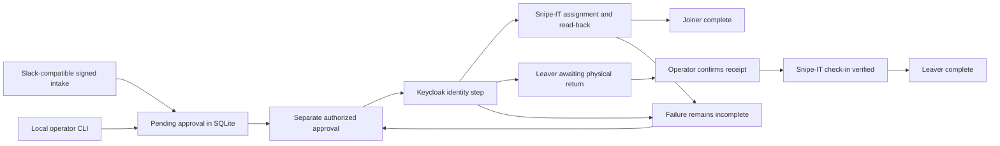

# Approved identity and asset workflow

## What is implemented

- Real local Keycloak provisioning and offboarding.
- Real local Snipe-IT v8.8.1 API inventory, checkout and check-in.
- A durable SQLite request queue with separate requester/approver roles.
- Retry after partial failure; repeated completed requests do not execute again.
- Offboarding remains awaiting_return after access removal. Only an authorized operator's receipt confirmation checks in the asset and closes the ticket.
- Slack-compatible request signing, timestamp validation, team allowlist and duplicate-request handling. Intake only queues; it never approves or provisions.
- Atomic, run-scoped verification reports that record startup and cleanup failures.

**Slack is not live-connected.** The current evidence uses a locally signed fixture, not a request received from Slack. No personal/developer workspace was available during this milestone. The template app manifest and intake endpoint are prepared for later installation.

## Architecture



## Start local services

Python 3.10+ and Docker Desktop with Linux containers are required. Use the same PowerShell terminal for the helper and identity commands:

```powershell
.\scripts\Start-KeycloakSandbox.ps1
$dockerExe = Join-Path $env:LOCALAPPDATA "Programs\DockerDesktop\resources\bin\docker.exe"
python -m sandbox.setup_assets --docker $dockerExe
python -m sandbox.verify_assets --run-live
```

Pass your actual Docker path if it is installed elsewhere. Snipe-IT is bound to 127.0.0.1:8090; its database is not published. Keycloak uses 127.0.0.1:8080. The separate Compose projects retain their own data volumes.

The Snipe bootstrap is for an empty private lab: it initializes a minimal settings record, creates its lab administrator with supported artisan commands, generates Passport signing keys and a personal-access client, and stores the API credential in ignored sandbox/assets/.env. Do not point this bootstrap at an existing organization instance. The lab API credential is privileged; production permission design is outside this increment.

## Live verification evidence

See [the archived observed results](../examples/asset-workflow-results.json). Eight checks passed against the real local services:

| Check | Observed result |
| --- | --- |
| Inventory fixture | Fictional user, laptop, model, category and deployable status created in Snipe-IT |
| Signed Slack fixture | One pending request; no identity created before approval |
| Unauthorized approval | Rejected |
| Approved joiner | Keycloak identity and Snipe assignment read back successfully |
| Asset-stage failure | Injected failure after identity step left ticket incomplete |
| Retry | Reused identity and existing assignment |
| Leaver | Keycloak disabled; laptop remained assigned and ticket awaited return |
| Receipt | Authorized operator assertion triggered verified check-in and ticket closure |

Physical shipment/receipt is not independently measured by software. The receipt command records the operator's assertion. Snipe-IT user records retain asset history; this workflow does not claim federation or removal of every SaaS application's login access.

## Manual request demo

```powershell
$env:LAB_APPROVERS = "lab-reviewer"
python -m sandbox.asset_workflow submit --ticket REQ-DEMO --action joiner --username lab-avery --asset LAB-DEMO --actor lab-requester
python -m sandbox.asset_workflow approve --ticket REQ-DEMO --actor lab-reviewer
python -m sandbox.asset_workflow process --ticket REQ-DEMO
python -m sandbox.asset_workflow show --ticket REQ-DEMO
```

The lab identity in Snipe-IT and LAB- asset must already exist. The live verifier creates its own fictional fixtures and is the quickest complete demo. Submit a leaver with a new ticket, approve it, and process it; then use receive with the authorized operator to confirm physical return.

Queue actions and each transition are persisted in output/operations.sqlite3. A crashed worker can remain processing and requires operator investigation; automatic lease recovery and distributed workers are outside this local lab. CLI actor names are local operator assertions, not authenticated remote identities.

## Slack installation boundary

1. Create a personal/developer workspace and a custom app using sandbox/slack-app-manifest.yaml.
2. Replace the placeholder HTTPS request URL with an endpoint you control that forwards to the loopback intake. No public tunnel or hosting is configured by this project.
3. Configure SLACK_SIGNING_SECRET and an explicit SLACK_TEAM_IDS allowlist locally; never paste secrets in chat or commit them.
4. Run python -m sandbox.slack_intake. The service listens on 127.0.0.1:8095.
5. Send /lab-onboard lab-username LAB-ASSET or /lab-offboard lab-username LAB-ASSET.
6. Inspect the queued request; approve and process it through the operator CLI.

Connecting the general Slack plugin can help inspect workspace context, but does not install this custom app or supply its signing secret. No bot token or outbound messaging is used by this increment.

## Evidence reliability

Runtime reports are written under output/verification and ignored by Git. Each run replaces an old report with running status before setup, uses a new run ID, then records passed, failed or incomplete atomically. Error messages are not copied into public reports; only exception types are recorded. Authentication cleanup failure is recorded separately without masking the original test failure.

Committed examples are historical snapshots. CI uploads only the current run's output directory, never old examples. A setup failure before a runner starts may produce no report; that is a missing artifact, not a passing result.

## AI assistance

Codex implemented and tested this increment. Review findings included stale-success artifacts, exception masking during cleanup, SQLite connection handles left open on Windows, Snipe-IT API logical errors carried in HTTP 200, and signing-key ownership in the new container. The project owner's walkthrough remains pending.

## Limits

No live Slack installation, Mac/MDM enrollment, Google Workspace, SAML or SCIM. The asset-stage failure is injected; the API operations around it are real. Existing Keycloak protocol evidence remains separately documented. This lab is not production deployment or compliance certification.

Sources: [Snipe-IT Docker setup](https://snipe-it.readme.io/docs/docker), [Snipe-IT API semantics](https://snipe-it.readme.io/reference/api-overview), [Slack request verification](https://docs.slack.dev/authentication/verifying-requests-from-slack/).
