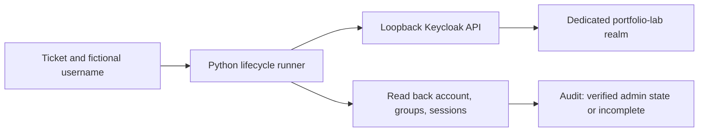

# Keycloak identity lifecycle sandbox

This extends the PowerShell CSV/JSON simulation with a Python client for a real local Keycloak Admin REST API. It provisions fictional users, assigns a lab group, disables users, ends their sessions, removes groups, and reads state back before reporting success.

## Current evidence

- Workflow contract and failure tests: 16 passed; run with the command below.
- Real Keycloak 26.8.1 container execution: seven checks passed on October 21, 2026. See [the case study](keycloak-case-study.md) and [sanitized results](../examples/keycloak-live-results.json).
- Login-form, PKCE, TOTP, active-session removal, refresh denial and access-token rejection at Keycloak: ten protocol checks passed. See [authentication verification](keycloak-auth-verification.md). SAML, SCIM, visual walkthrough and downstream/offline validation remain separate.
- Project owner's personal review and demonstration: pending.

Passing contract tests is not evidence of a completed live integration. Do not describe this as production IAM or Rippling experience.

## Architecture



| Existing simulation | Keycloak extension |
| --- | --- |
| PowerShell; CSV and JSON state | Python standard library; HTTP API |
| Simulated licenses and MFA flags | Actual sandbox identity and membership operations |
| No external identity system | Local Keycloak required |
| Run existing scripts unchanged | Run the module below |

## Setup on a Docker-enabled machine

Requires Python 3.10+ and Docker Desktop with Compose. From the repository root in PowerShell:

```powershell
.\scripts\Start-KeycloakSandbox.ps1
```

The helper finds Docker on PATH or in the usual per-user/system install locations, creates local secrets once in ignored `sandbox/.env`, starts the named `portfolio-identity-lab` project, and waits for realm discovery to respond. It loads `LAB_CLIENT_SECRET` into the current PowerShell process for the Python commands below. Keep using that same terminal, or rerun the helper in a new terminal.

The service is bound to `127.0.0.1:8080`; dev mode is intended only for this local lab. The imported service account has user/group administration roles in `portfolio-lab`. This is not a least-privilege production role design.

The named volume retains state. Existing realms are skipped during startup import: retain the ignored `.env` file between restarts, or explicitly rotate the runner secret through the local admin console. Changing environment values alone does not rotate credentials in an existing realm. No credentials belong in Git or screenshots.

## Exercise

```powershell
python -m sandbox.keycloak_lifecycle joiner --username lab-avery --ticket REQ-101
python -m sandbox.keycloak_lifecycle joiner --username lab-avery --ticket REQ-101-RETRY
python -m sandbox.keycloak_lifecycle leaver --username lab-avery --ticket REQ-102
python -m sandbox.keycloak_lifecycle leaver --username lab-avery --ticket REQ-102-RETRY
```

The second joiner must reuse the identity. Repeated offboarding must remain safe. A disabled identity cannot be silently reactivated by a new joiner request: a rehire requires a separate review.

Inspect `output/keycloak-audit.jsonl`. Each run writes ticket-scoped step outcomes. A failure leaves an `incomplete` record and returns nonzero; correct the problem and retry the same workflow. Authentication/API error bodies and tokens are never written to the audit.

A failure before account creation does not need cleanup. A failure after disablement leaves the account disabled and the remaining steps incomplete. There is no automatic rollback that re-enables an offboarded user.

## What offboarding verification means

Successful output is `admin_state_verified`, not "all access revoked." The runner checks disabled account state, zero group memberships, and zero returned Keycloak user sessions. Existing access tokens can remain valid until expiry at services that validate them offline; application sessions and offline sessions require separate investigation. No login password is set by the joiner, so this increment cannot demonstrate a successful end-user login or its subsequent denial.

A separate [authentication harness](keycloak-auth-verification.md) now demonstrates real login-form requests before offboarding and denial afterward, with TOTP and token endpoint checks. It establishes active sessions and verifies their removal. This is HTTP protocol automation; a production relying-party application, visual walkthrough, SCIM and downstream/offline token behavior remain separate.

## Automated tests

```powershell
python -m unittest discover -s tests -v
```

Tests use a stateful API contract double and injected transport failures. They cover duplicate provisioning, repeated offboarding, failed logout and recovery, denied authentication, ambiguous identity lookup, missing groups, failed disable read-back, rehire refusal, unknown users, loopback restrictions, and unavailable services. They do not execute a Keycloak server.

## Evidence to collect after the real sandbox run

| Evidence | Expected result | Actual result |
| --- | --- | --- |
| First joiner | One enabled identity; lab-support membership | Passed |
| Repeated joiner | Same identity; no duplicates | Passed |
| Leaver | Disabled; no groups; no user sessions returned | Passed; no active user session was established |
| Repeated leaver | Same verified state | Passed |
| Stopped service | Workflow failure; incomplete audit record | Passed |
| Restart and retry | Recorded recovery; verified admin state | Passed |
| Owner walkthrough | Explain scopes, failure handling, token limitations | Pending |

Capture sanitized screenshots of account/group state and a ticket timeline; publish no credentials, cookies, tokens, or recovery keys.

## Repeat the live verification

After running the helper in the same PowerShell terminal:

```powershell
$dockerExe = Join-Path $env:LOCALAPPDATA "Programs\DockerDesktop\resources\bin\docker.exe"
python -m sandbox.verify_live --run-live --docker $dockerExe
```

If Docker is installed elsewhere, pass that executable path instead. The opt-in runner creates a fresh fictional user, deliberately stops and restarts only the `portfolio-identity-lab` Keycloak service, checks recovery, and writes `output/verification/keycloak-live-results.json`. It appends private step records to ignored `output/keycloak-live-audit.jsonl`. Runtime results are ignored by Git. Committed examples are historical snapshots; copy a result into examples only when intentionally archiving reviewed evidence.

## Sources

- [Keycloak Admin REST API](https://www.keycloak.org/docs-api/latest/rest-api/index.html)
- [Container setup](https://www.keycloak.org/server/containers)
- [Realm import and environment placeholders](https://www.keycloak.org/server/importExport)
