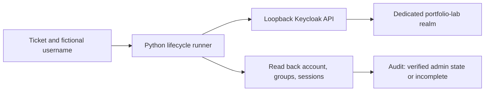

# Keycloak identity lifecycle sandbox

This extends the PowerShell CSV/JSON simulation with a Python client for a real local Keycloak Admin REST API. It provisions fictional users, assigns a lab group, disables users, ends their sessions, removes groups, and reads state back before reporting success.

## Current evidence

- Workflow contract and failure tests: run with the command below.
- Real Keycloak container execution: pending on a Docker-enabled machine.
- Interactive OIDC sign-in, MFA, SAML, SCIM, and downstream application revocation: not implemented or verified by this increment.
- Project owner's personal review and demonstration: pending.

Passing contract tests is not evidence of a completed live integration. Do not describe this as production IAM or Rippling experience.

## Architecture



| Existing simulation | Keycloak extension |
| --- | --- |
| PowerShell; CSV and JSON state | Python standard library; HTTP API |
| Simulated licenses and MFA flags | Actual sandbox identity and membership operations |
| No external identity system | Local Keycloak required |
| Run existing scripts unchanged | Run the module below |

## Setup on a Docker-enabled machine

Requires Python 3.10+ and Docker Compose. From the repository root in PowerShell, create unique local sandbox secrets without pasting them into chat:

```powershell
$env:LAB_ADMIN_PASSWORD = [guid]::NewGuid().ToString("N") + [guid]::NewGuid().ToString("N")
$env:LAB_CLIENT_SECRET = [guid]::NewGuid().ToString("N") + [guid]::NewGuid().ToString("N")
docker compose -f sandbox/compose.yaml up -d
```

Wait for startup to complete using `docker compose -f sandbox/compose.yaml logs keycloak`. The service is bound to `127.0.0.1:8080`; dev mode is intended only for this local lab. The realm import creates a service account restricted to user/group operations in `portfolio-lab`. Administrative bootstrap credentials remain local.

The named volume retains state. Existing realms are skipped during startup import: retain your original secret between restarts, or explicitly update the runner client's secret through the local admin console. Generating new environment secrets does not rotate credentials in an existing realm.

## Exercise

```powershell
python -m sandbox.keycloak_lifecycle joiner --username lab-avery --ticket REQ-101
python -m sandbox.keycloak_lifecycle joiner --username lab-avery --ticket REQ-101-RETRY
python -m sandbox.keycloak_lifecycle leaver --username lab-avery --ticket REQ-102
python -m sandbox.keycloak_lifecycle leaver --username lab-avery --ticket REQ-102-RETRY
```

The second joiner must reuse the identity. Repeated offboarding must remain safe. A disabled identity cannot be silently reactivated by a new joiner request: a rehire requires a separate review.

Inspect `output/keycloak-audit.jsonl`. Each run writes ticket-scoped step outcomes. A failure leaves an `incomplete` record and returns nonzero; correct the problem and retry the same workflow. Authentication/API error bodies and tokens are never written to the audit.

A failure before account creation does not need cleanup. A failure after disablement leaves the account disabled and the remaining steps incomplete. There is no automatic rollback that re-enables an offboarded user.

## What offboarding verification means

Successful output is `admin_state_verified`, not "all access revoked." The runner checks disabled account state, zero group memberships, and zero returned Keycloak user sessions. Existing access tokens can remain valid until expiry at services that validate them offline; application sessions and offline sessions require separate investigation. No login password is set by the joiner, so this increment cannot demonstrate a successful end-user login or its subsequent denial.

Before claiming end-to-end access verification, add an OIDC test application, demonstrate sign-in before offboarding, verify sign-in denial afterward, and measure existing token/session behavior. MFA and SCIM are separate milestones.

## Automated tests

```powershell
python -m unittest discover -s tests -v
```

Tests use a stateful API contract double and injected transport failures. They cover duplicate provisioning, repeated offboarding, failed logout and recovery, denied authentication, ambiguous identity lookup, missing groups, failed disable read-back, rehire refusal, unknown users, loopback restrictions, and unavailable services. They do not execute a Keycloak server.

## Evidence to collect after the real sandbox run

| Evidence | Expected result | Actual result |
| --- | --- | --- |
| First joiner | One enabled identity; lab-support membership | Pending |
| Repeated joiner | Same identity; no duplicates | Pending |
| Leaver | Disabled; no groups; no user sessions returned | Pending |
| Repeated leaver | Same verified state | Pending |
| Stopped service | Nonzero exit; incomplete audit record | Pending |
| Restart and retry | Recorded recovery; verified admin state | Pending |
| Owner walkthrough | Explain scopes, failure handling, token limitations | Pending |

Capture sanitized screenshots of account/group state and a ticket timeline; publish no credentials, cookies, tokens, or recovery keys.

## Sources

- [Keycloak Admin REST API](https://www.keycloak.org/docs-api/latest/rest-api/index.html)
- [Container setup](https://www.keycloak.org/server/containers)
- [Realm import and environment placeholders](https://www.keycloak.org/server/importExport)
